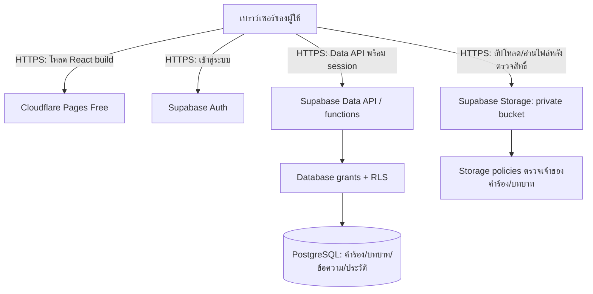

# แผน Cloud และ Storage สำหรับ OneService Central

วันที่ตรวจข้อมูล: 28 ตุลาคม 2026 (Asia/Bangkok)

สถานะ: แผนสำหรับโปรเจกต์รายวิชา ยังไม่ได้สร้างบัญชี/ทรัพยากรคลาวด์ ย้ายข้อมูล หรือแก้โค้ดแอป

## 1. เป้าหมายและเงื่อนไขจากผู้ใช้

- ใช้บริการที่มีแผนฟรี เป้าหมายค่าใช้บริการเป็น 0 บาทภายใต้โควตา ไม่เช่า VM หรือเปิดบริการเสียเงิน
- ทำเพื่อส่งโปรเจกต์วิชา ไม่ได้เตรียมระบบ Production หรือขยายเป็นธุรกิจ
- เลือก Supabase ได้ และโจทย์ยอมให้อธิบายรายการ CPU/RAM/Network/OS ตามลักษณะบริการที่ใช้ โดยหลายรายการระบุว่า “ถ้ามี”
- ให้เว็บเข้าถึงผ่านอินเทอร์เน็ตและใช้ข้อมูลร่วมกันจากคนละเบราว์เซอร์ได้จริง
- ขอบเขตนี้เป็นการวางแผน การลงมือทำเป็นงานถัดไปเมื่อผู้ใช้สั่ง

## 2. หลักฐานจากเอกสารเรียน

อ้างอิงหมายเลขหน้า PDF ซึ่งอาจต่างจากเลขที่พิมพ์บนสไลด์บางบท

| เอกสาร | หน้าที่เกี่ยวข้อง | นำมาใช้กับแผน |
|---|---|---|
| Chapter01-Introduction to Cloud Computing.pdf | 9–15, 23 | แบ่งความรับผิดชอบ IaaS/PaaS และใช้ Public Cloud พร้อม IAM |
| Chapter02-CloudInfra_Virtualization.pdf | 6–10, 24–28 | อธิบาย Region และทรัพยากร; ไม่อ้าง HA หรือจัดสรร VM เมื่อไม่ได้ทำ |
| Chapter03-VM_Linux_Command.pdf | 10–11, 44–50 | เข้าใจงานดูแล OS/Process/Network ที่ Managed Platform ช่วยลด; ไม่จำเป็นต้องเช่า VM เพียงเพราะมีบทนี้ |
| Chapter04_Cloud_Storage.pdf | 5–18 | แยกข้อมูลฐานข้อมูลกับ Object Storage; File Storage ใช้เมื่อมีงานแชร์ไฟล์แบบ NFS/SMB |
| Chapter04_Cloud_Storage.pdf | 20–31, 33 | Backup/Replication/Snapshot ต่างกัน; เลือก tier ตามการใช้งาน; มี Demo Supabase Object Storage |
| Chapter05-Cloud_Architecture_Design.pdf | 4–12, 15–22 | เริ่มจาก Requirement/Workload/Sizing/Cost และเลือกสถาปัตยกรรมตามขนาดงาน |
| Chapter06-Docker.pdf | 5–8, 17, 20–22 | Container และข้อมูลถาวร; ใช้ Managed Deployment ได้โดยไม่ต้องจัด Docker บน VM |
| Chapter07-Kubernates.pdf | 2–8 | Kubernetes เหมาะกับงานจัดการหลาย Container/หลายเครื่อง; ไม่เพิ่ม cluster ในแผนส่งงานขนาดเล็ก |
| Chapter08-Cloud_Security_Migration.pdf | 4–11, 13–18, 20–33, 35–37 | Shared Responsibility, Auth/Authorization, Least Privilege, HTTPS, Backup และการตรวจหลังย้ายข้อมูล |

โจทย์ร้านค้าออนไลน์/จำนวนผู้ใช้/ขนาดฐานข้อมูลในบท 5 เป็นตัวอย่างของบทเรียน ไม่ถือเป็น Requirement ของ OneService โดยอัตโนมัติ

## 3. สิ่งที่มีอยู่ในโค้ด

- React + TypeScript + Vite เป็น Frontend; build ออกเป็นไฟล์ใน `dist/`
- `src/context/ServiceDeskContext.tsx` เก็บคำร้องและบทบาทใน LocalStorage ยังไม่ใช่ฐานข้อมูลร่วมกัน
- มี users/departments/services/tickets/comments/activities และ CSAT ซึ่งเป็นข้อมูลที่สัมพันธ์กัน เหมาะกับ PostgreSQL
- การสลับบทบาทเป็นการสาธิต และ Internal Note ถูกซ่อนใน UI; การนำขึ้นระบบข้อมูลร่วมต้องตรวจสิทธิ์ที่ฐานข้อมูลด้วย
- ยังไม่มีฟิลด์/ขั้นตอนอัปโหลดไฟล์แนบในข้อมูล Ticket จึงเป็นงานที่ต้องเพิ่มหากต้องการ Demo Object Storage
- การ export CSV อยู่ในเบราว์เซอร์ ไม่ต้องสร้างระบบประมวลผลรายงานบนเซิร์ฟเวอร์เพิ่ม

## 4. สถาปัตยกรรมที่แนะนำ

**Cloudflare Pages Free + Supabase Free (Hosted)**

| ส่วน | บริการที่เสนอ | หน้าที่ |
|---|---|---|
| Frontend Hosting | Cloudflare Pages Free | เก็บไฟล์ build ของ React และเปิด URL HTTPS ผ่านโดเมน `pages.dev` |
| Authentication | Supabase Auth | บัญชีสาธิต requester/officer/executive ที่เข้าสู่ระบบจริง |
| Database | Supabase PostgreSQL Free | เก็บคำร้อง ข้อความ บทบาท และประวัติที่แชร์กันระหว่างอุปกรณ์ |
| Object Storage | Supabase Storage private bucket | เก็บไฟล์แนบรูปภาพ/PDF และเก็บเฉพาะ metadata ใน PostgreSQL |
| Authorization | PostgreSQL grants + RLS และ Storage policies | ตรวจสิทธิ์แต่ละบัญชีแทนการพึ่งการซ่อนปุ่ม |
| Business transactions | Database functions/triggers ที่ออกแบบสิทธิ์อย่างรัดกุม | จัดการการเปลี่ยนสถานะ การรับเคส โอนย้าย และประวัติแบบ transaction |

ใช้ Supabase SDK เรียกบริการผ่าน HTTPS จึงไม่ต้องมี Express Server, VM, Cloud Run, Cloud SQL หรือ Kubernetes เพิ่มในขอบเขตนี้

Supabase เป็น BaaS (Backend as a Service); เมื่อต้องเลือกในกรอบ IaaS/PaaS ของรายวิชา ให้อธิบายว่าเป็นแนวทาง PaaS/Managed Backend โดยผู้ให้บริการดูแล OS/Runtime/Infrastructure และเราดูแล schema/สิทธิ์/ข้อมูล/แอป

Frontend อยู่ Cloudflare แต่ฐานข้อมูลและไฟล์แนบอยู่ภายในบริการ Supabase เดียวกัน ไม่ได้ต่อ Google Cloud Storage/S3 bucket ที่เราจัดการเอง และไม่เรียกการใช้สองผู้ให้บริการนี้ว่า Hybrid Cloud โดยอัตโนมัติ

## 5. คำตอบสำหรับหัวข้อคลาวด์ในงานนำเสนอ

ตารางนี้เป็นค่าของแผนที่เสนอ ไม่ใช่หลักฐานว่าตั้งค่าบนบัญชีจริงแล้ว

| หัวข้ออาจารย์ | คำตอบตามแผน |
|---|---|
| ผู้ให้บริการ | Supabase สำหรับ Backend และ Cloudflare สำหรับ Frontend |
| IaaS หรือ PaaS | PaaS/Managed Platform; Supabase จัดเป็น BaaS โดยเฉพาะ ไม่มี VM ที่ผู้ใช้บริหารเอง |
| Region | เลือก **Specific Region: Singapore `ap-southeast-1`** สำหรับ Supabase เมื่อมีให้เลือก; Pages ส่ง static assets ผ่านเครือข่ายกระจายทั่วโลก ไม่เลือก VM region ให้ Pages |
| เหตุผล Region | อยู่ในเอเชียตะวันออกเฉียงใต้ เหมาะเป็นตัวเลือกสำหรับผู้ใช้ไทย; ยังไม่อ้างตัวเลข latency เพราะต้องวัดจริง |
| ประเภท Storage | PostgreSQL เก็บข้อมูลสัมพันธ์; Supabase Object Storage เก็บไฟล์แนบ ไม่ใช้ NFS/SMB |
| อยู่คลาวด์เดียวกันหรือไม่ | Database และไฟล์อยู่ในโปรเจกต์ Supabase เดียวกัน ส่วนไฟล์หน้าเว็บอยู่ Cloudflare |
| Disk / Database size | ใช้ **Database quota 500 MB** ของ Free plan ไม่ใช่การเช่า boot disk 500 MB; ขนาดดิสก์/SSD ภายในผู้ให้บริการเป็นผู้จัดการ |
| File Storage | ใช้โควตาไฟล์ **1 GB** ของ Free plan; bucket ไม่ใช่ดิสก์ที่จองล่วงหน้า |
| CPU | Nano compute แบบ **Shared CPU** ตาม Free plan ไม่ระบุจำนวน dedicated vCPU เพราะแพ็กเกจไม่ได้ระบุเช่นนั้น |
| RAM | เอกสาร Compute ระบุ Nano **Up to 0.5 GB** เป็น RAM ฝั่งฐานข้อมูล ไม่ใช่ RAM ของเบราว์เซอร์ และไม่เลือกขยายเป็นรุ่นเสียเงิน |
| เหตุผล CPU/RAM | เลือกแพ็กเกจฟรีสำหรับ CRUD/สาธิตงานขนาดเล็ก โดยต้องทดสอบจริง ไม่รับรองจำนวนผู้ใช้พร้อมกันจากสเปกเพียงอย่างเดียว |
| Network Bandwidth | ไม่เลือกความเร็วสาย 100 Mbps/1 Gbps เอง; Free plan ระบุ egress 5 GB และ cached egress 5 GB แยกหมวด ไม่เหมารวมว่าเป็นโควตาชนิดเดียวกัน 10 GB |
| OS | ไม่ได้เลือก/ติดตั้ง Guest OS เอง ผู้ให้บริการดูแลระบบ ไม่อ้าง Ubuntu/Debian เวอร์ชันใดโดยไม่มีข้อมูล |
| Network / Firewall | ไม่มี VPC/subnet/VM firewall ที่จัดเอง ใช้ HTTPS และตรวจสิทธิ์ด้วย Auth, database grants, RLS และ private Storage; RLS เป็น authorization ไม่ใช่ network firewall |
| Docker / Kubernetes | ไม่ใช้สำหรับ deployment ที่เสนอ ไม่ต้องติดตั้ง cluster เอง การเรียน Docker/Kubernetes ไม่ได้แปลว่าใช้จริงในระบบนี้ |
| ค่าใช้จ่าย | เป้าหมาย $0 เมื่อใช้ Free plan และอยู่ในข้อจำกัด ใช้โดเมนฟรี ไม่เปิด add-on หรืออัปเกรดเป็น paid |

โควตาและเงื่อนไขตรวจจากเอกสารทางการวันที่ 28 ตุลาคม 2026 ต้องตรวจใน Dashboard อีกครั้งก่อนสร้างโปรเจกต์/ถ่ายภาพสไลด์

## 6. แผนข้อมูลและ Storage

### ฐานข้อมูล PostgreSQL

ตารางเริ่มต้น: `profiles`, `departments`, `services`, `tickets`, `ticket_comments`, `ticket_activities`, `ticket_attachments`

- `profiles.id` ผูกกับ `auth.users.id`; role และ department ถูกกำหนดโดยผู้ดูแล ผู้ใช้แก้ role ของตัวเองไม่ได้
- Ticket ใช้ UUID และรหัสที่สร้างฝั่งฐานข้อมูลพร้อม unique constraint ไม่สร้างรหัสจากจำนวนรายการในเบราว์เซอร์
- ข้อมูล custom fields ใช้ JSONB ได้เพื่อรักษาแบบฟอร์มที่มีอยู่
- Comments/Activities แยกแถวเพื่อ query และกำหนดสิทธิ์ ไม่เขียนทับทั้ง Ticket JSON ทุกครั้ง
- สถานะ ผู้รับผิดชอบ เวลา SLA และ audit fields ตรวจ/สร้างฝั่งฐานข้อมูล ไม่ยอมรับค่าที่อ้างผู้กระทำจาก client โดยตรง
- ใช้ foreign keys และ indexes ตาม requester, department, status, created_at และ ticket_id ตาม query ที่ใช้งานจริง
- สถิติที่แสดงควรคำนวณจากข้อมูลจริง เช่น MTTR แทนค่าคงที่ตัวอย่าง

### Object Storage

- bucket ชื่อ `ticket-attachments` แบบ private
- path ตัวอย่าง `tickets/{ticket_uuid}/{random_uuid}.pdf`; เก็บชื่อเดิม, MIME, size, uploader, object path และ ticket_id ในตาราง metadata
- ข้อเสนอข้อจำกัดของแอป: PNG/JPEG/PDF ขนาดไม่เกิน 2 MB ต่อไฟล์ และไม่เกิน 5 ไฟล์ต่อคำร้อง (ตัวเลขนี้เป็นนโยบายที่เสนอ ไม่ใช่โควตา Supabase)
- ตั้ง bucket restrictions และ policies ไม่ใช่ตรวจเฉพาะบนหน้าจอ; จำนวนไฟล์ต่อ Ticket ต้องตรวจแบบป้องกันการส่งพร้อมกันเกินจำนวน
- อ่านไฟล์ผ่าน authenticated download หรือ signed URL อายุสั้นที่ออกหลังตรวจสิทธิ์ ผู้ถือ signed URL ที่ยังใช้ได้สามารถเปิดไฟล์ได้ จึงไม่บันทึก URL ถาวรลง Ticket
- อัปโหลด/บันทึก metadata ต้องมีแนวทาง cleanup เมื่อขั้นตอนหนึ่งล้มเหลว และไม่ลบประวัติหรือไฟล์ต้นฉบับระหว่าง Demo โดยอัตโนมัติ
- CSV ที่ export จากหน้าเว็บดาวน์โหลดเข้าเครื่องโดยตรง ไม่ต้องสะสมสำเนาใน bucket

### การประเมินพื้นที่สำหรับชุด Demo

ตัวอย่างสำหรับวางแผนเท่านั้น ไม่ใช่ปริมาณข้อมูลที่ผู้ใช้ยืนยัน:

- หากมี 100 คำร้อง และข้อมูลรวมข้อความ/ประวัติเฉลี่ย 50 KB ต่อคำร้อง จะประมาณ 5 MB ก่อน indexes/overhead
- หากมี 100 ไฟล์ เฉลี่ย 2 MB จะประมาณ 200 MB
- ใช้เป็นกรอบจัดชุดสาธิต โดยวัดการใช้จริงจาก Dashboard หลัง seed/upload; ไม่ใส่ไฟล์ใหญ่หรือข้อมูลส่วนบุคคลจริง
- เลือก Object Storage สำหรับไฟล์เพราะเรียกผ่าน API และควบคุมสิทธิ์ได้; ยังไม่มีความต้องการ shared filesystem จึงไม่เพิ่ม File Storage
- ใช้การเก็บไฟล์เพื่อเปิดอ่านทันทีตามรูปแบบบริการ Supabase ไม่อ้างว่าเลือก GCS Standard/S3 Glacier หรือมี Hot/Cold tier ที่ไม่ได้ตั้งจริง

## 7. สิทธิ์ขั้นต่ำที่ต้องพิสูจน์ได้

| บัญชี | ขอบเขตข้อมูล |
|---|---|
| requester | สร้าง/อ่านคำร้องของตน ส่ง public comment อ่านไฟล์ของคำร้องตน และประเมินงานของตน |
| officer | อ่าน/จัดการคำร้องของแผนกที่ได้รับอนุญาต รวม Internal Note ตามขอบเขตที่กำหนด |
| executive | อ่านภาพรวมตามสิทธิ์ที่ตกลง และเข้าถึงข้อมูลที่จำเป็นสำหรับรายงาน |
| ผู้ไม่เข้าสู่ระบบ | เข้าเว็บหน้า Login ได้ แต่เรียกข้อมูลคำร้อง/ไฟล์ไม่ได้ |

- กำหนด grants และ RLS ทุกตารางที่เปิดให้ Data API และ Storage policies ให้สอดคล้องกัน
- Internal Note ต้องถูกกันที่ query/ฐานข้อมูล ไม่ส่งมาถึง requester แล้วค่อยซ่อนด้วย React
- เปลี่ยน role ใน LocalStorage หรือส่ง request ตรงต้องเพิ่มสิทธิ์ไม่ได้
- React ใช้เฉพาะ Supabase URL และ publishable key; ห้ามฝัง secret key / legacy service_role / DB password ใน `VITE_*` หรือ source
- ใช้บัญชีสาธิตที่สร้างไว้ก่อนวันสอบ ไม่พึ่งสมัครสมาชิก/รับอีเมลยืนยันสดระหว่างนำเสนอ
- UI สลับบทบาทเดิมต้องไม่กลายเป็นช่องทางเปลี่ยนสิทธิ์จริง การ Demo แต่ละบทบาทใช้บัญชีของบทบาทนั้น

## 8. Backup และการเตรียมวัน Demo

- Free projects อาจถูก pause เมื่อไม่มีการใช้งานหนึ่งสัปดาห์ จึงตรวจสถานะและทดลอง Login/CRUD ล่วงหน้าก่อนวันสอบ ไม่รับรอง uptime แบบ Production
- เก็บ schema/migrations และ seed ที่เป็นข้อมูลสมมติใน source control เพื่อสร้างระบบกลับมาได้
- export ฐานข้อมูลก่อนวันนำเสนอและเมื่อเปลี่ยนชุดข้อมูลสำคัญ เก็บนอกโปรเจกต์ Supabase และนอก `dist/`/public repo
- backup ไฟล์แนบแยกจาก SQL dump เพราะ database backup ไม่รวม bytes ของ Storage objects
- ทดสอบ restore schema/data และไฟล์ตัวอย่างอย่างน้อยหนึ่งครั้งในที่ทดสอบที่ไม่เขียนทับโปรเจกต์หลัก; ไม่จำเป็นต้องเปิดคลาวด์เพิ่มถ้าทดสอบ local ได้
- บัญชี Auth/รหัสผ่าน/keys ต้องเตรียมแยกตามวิธี restore ที่เลือก ไม่ถือว่าการ export เฉพาะตารางแอปทำให้ Login กลับมาได้ครบอัตโนมัติ
- ตรวจ Usage ให้ไม่ใกล้ quota; ไม่เปิด paid add-ons, paid SMTP, custom domain หรือฐานข้อมูลเสียเงิน

## 9. ลำดับดำเนินงาน

รายละเอียด task/acceptance/dependencies อยู่ใน `tasks/todo.md`

1. ยืนยัน Free plan/Region และกำหนดชุด Demo
2. ทำ Login จริงและสิทธิ์ profile
3. ย้ายเส้นทางสร้าง/อ่าน Ticket ให้ใช้ฐานข้อมูลร่วม พร้อม RLS
4. เชื่อมคิวงาน สถานะ โอนย้าย ข้อความ และประวัติ
5. เพิ่มไฟล์แนบ private เพื่อ Demo Object Storage
6. เชื่อม Dashboard/CSAT กับข้อมูลจริงตามขอบเขตสิทธิ์
7. Build และเผยแพร่ static site บน Cloudflare Pages
8. ทดสอบคนละบัญชี/คนละอุปกรณ์, backup/restore และเก็บภาพหลักฐานสำหรับสไลด์

ไม่เพิ่มระบบแชต push/realtime/แจ้งอีเมล/CI ซับซ้อนหากไม่จำเป็นต่อ Demo; รีเฟรชรายการหลังบันทึกหรือเปลี่ยนหน้าได้ก่อน

## 10. หลักฐานตรงเกณฑ์รายวิชา

| เกณฑ์ | หลักฐานที่ต้องเตรียม |
|---|---|
| ใช้งานจริงผ่าน Internet | เปิด URL ผ่านมือถือเครือข่ายภายนอก และอีกบัญชีเห็นคำร้องที่อนุญาต |
| แผนภาพ Cloud | ภาพ Browser → Pages / Supabase Auth / Data API → PostgreSQL / private Storage ตรงระบบจริง |
| เหตุผลเลือก Cloud/ทรัพยากร | ภาพ Free plan, specific Region, DB/File quota, compute Nano และ Usage พร้อมคำอธิบาย |
| นำเสนอ/ตอบคำถาม | สาธิต Login → ส่ง Ticket → เจ้าหน้าที่รับเรื่อง → แนบไฟล์ → อัปเดต → ประเมินผล และอธิบาย N/A ของ VM/OS/Kubernetes |
| ส่งสไลด์และ Source | source, migrations, README วิธีรัน/deploy, `.env.example` ไม่มี secrets และไฟล์สไลด์ |

## 11. แหล่งอ้างอิง

- เอกสารวิชา: `docs/Chapter01-Introduction to Cloud Computing.pdf` ถึง `docs/Chapter08-Cloud_Security_Migration.pdf` ตามตารางหน้าในหัวข้อ 2
- [Supabase Pricing](https://supabase.com/pricing)
- [Supabase Compute and Disk](https://supabase.com/docs/guides/platform/compute-and-disk)
- [Supabase Regions](https://supabase.com/docs/guides/platform/regions)
- [Supabase Database](https://supabase.com/docs/guides/database/overview)
- [Supabase Storage Buckets](https://supabase.com/docs/guides/storage/buckets/fundamentals)
- [Supabase Row Level Security](https://supabase.com/docs/guides/database/postgres/row-level-security)
- [Supabase API Keys](https://supabase.com/docs/guides/getting-started/api-keys)
- [Supabase Backups](https://supabase.com/docs/guides/platform/backups)
- [Cloudflare Pages React](https://developers.cloudflare.com/pages/framework-guides/deploy-a-react-site/)
- [Cloudflare Pages Limits](https://developers.cloudflare.com/pages/platform/limits/)

## 12. การตรวจแผน

- ตรวจรายการ PDF ทั้ง 8 บท โดยอ่าน text และภาพสไลด์สำหรับบทที่เป็นรูปภาพ
- เทียบกับโค้ด Context, types, รายงาน และข้อจำกัดของ frontend ปัจจุบัน
- เทียบ CPU/RAM/Region/โควตา/การ pause/backup กับเอกสารผู้ให้บริการทางการ
- ทุกขนาดข้อมูลตัวอย่างติดป้ายว่าเป็นตัวอย่าง ไม่ใช้เป็นผลวัดจริงหรือข้อกำหนดผู้ใช้
- ไม่อ้างว่า Database quota เท่ากับ boot disk, Shared CPU เท่ากับ dedicated vCPU หรือ egress เท่ากับความเร็วสาย
- ยังไม่มีการ deploy หรือทดสอบ Supabase integration; การตรวจรอบนี้เป็นการตรวจเอกสารและความสอดคล้องของแผน
